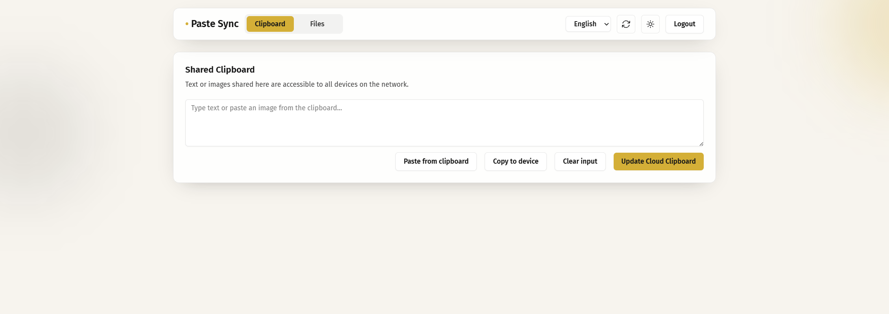
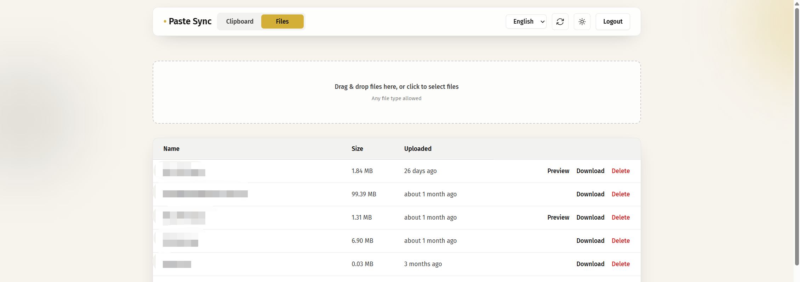
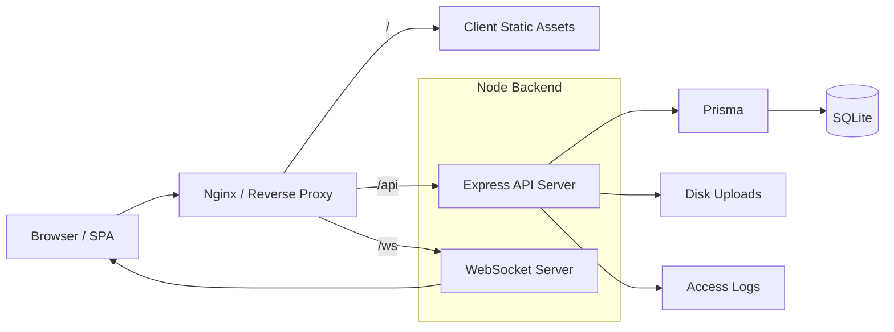

# Paste Sync

A password-gated clipboard and file sharing app for quickly syncing text, clipboard images, and files across your own devices on a LAN or through a public reverse proxy.

[中文说明](./README_zh.md)

## Screenshots

### Clipboard



### Files



## Architecture



## Features

- **Multi-account Login**: Sign in with a username and password and receive a JWT valid for 7 days. Accounts are declared through the `USERS` environment variable.
- **Per-account Isolation**: Each account has its own clipboard (text and image) and its own file list. Accounts cannot see or affect each other's data, and real-time updates are only delivered to the owning account.
- **Clipboard Sync**: Supports text plus uploading, viewing, and clearing the current clipboard image.
- **File Sharing**: Upload, download, delete, and preview image files.
- **Transfer Progress**: Shows upload/download progress and supports cancelling in-flight transfers.
- **Real-time Refresh**: Uses WebSocket events to refresh clipboard and file state.
- **Language and Theme Support**: Chinese / English plus Light / Dark / System themes.
- **Docker Deployment**: Quick startup with Docker Compose.

## Quick Start

### Requirements

- Docker + Docker Compose, or
- Node.js 18+ + npm

### Install

```bash
git clone https://github.com/AlakaSquasho/paste_sync.git
cd paste_sync
npm install
```

### Run with Docker

You can deploy with prebuilt images or build locally from source.

Use prebuilt images:

```bash
docker-compose -f docker-compose.image.yml up -d
```

Build locally:

```bash
docker-compose up -d --build
```

Keeping two Compose files is recommended: `docker-compose.yml` for local builds and `docker-compose.image.yml` for prebuilt images. Both can share the same ports, volumes, and environment variables; only `build` changes to `image`.

Access:
- Frontend: http://localhost:8080
- Backend: http://localhost:3000

### Run locally for development

```bash
npm run dev
```

Access:
- Frontend: http://localhost:5173 (default, configurable via `VITE_DEV_PORT`)
- Backend: http://localhost:3000 (default, configurable via `PORT`)

### Production build

```bash
npm run build
npm run start
```

## Auth and Sync

- Login endpoint: `POST /api/auth/login` with `{ "username": ..., "password": ... }`
- REST auth: `Authorization: Bearer <token>`
- WebSocket auth: `/ws?token=...`
- The server broadcasts `clipboard_updated` and `files_updated`, and clients refetch the relevant REST data

Accounts are defined by the `USERS` environment variable, a comma-separated list of `username:password` pairs. Passwords may be plaintext or a Bcrypt hash, and an account is identified by its username everywhere (database rows, upload directories, and the JWT `sub` claim). Requests are scoped to the authenticated account, so a file or clipboard entry belonging to another account is not reachable even with a valid token.

Events are delivered only to the sockets belonging to the account that changed, so another account's browser never refreshes on your changes.

## Storage and Deployment

- Database: SQLite (via Prisma)
- General files: `server/uploads/<username>/`
- Clipboard images: `server/uploads/clipboard/<username>/`
- Logs: `server/logs/`
- Docker persists database, uploads, and logs via mounted volumes

Data created before multi-account support is moved into the default account's directories on the first startup after upgrading — see [Upgrading from a Single Account](#upgrading-from-a-single-account).

A public reverse-proxy template is included: `nginx.reverse-proxy.template.conf`. This lets you expose the app through your own domain or HTTPS gateway, so it can be used beyond the local network when the proxy is configured securely.

- `/` → `127.0.0.1:8080`
- `/api`, `/ws` → `127.0.0.1:3000`

If you set `MAX_UPLOAD_SIZE_MB`, keep outer Nginx `client_max_body_size` aligned with it.

## Configuration

Configure these through `docker-compose.yml` or `.env` (see `.env.example`):

- `USERS`: comma-separated `username:password` accounts, e.g. `USERS='alice:$2b$10$...,bob:plainpassword'`. Passwords may be plaintext or Bcrypt. Usernames must match `[A-Za-z0-9._-]{1,32}` and are compared case-insensitively.
- `DEFAULT_ACCOUNT`: account that inherits data created before multi-account support. Defaults to the first entry in `USERS`.
- `SHARED_PASSWORD`: legacy single-account fallback, used only when `USERS` is empty. Creates one account named `DEFAULT_ACCOUNT` (or `default` when that is unset).
- `JWT_SECRET`: JWT signing secret. Required — empty or placeholder values are rejected at startup, because a guessable secret lets anyone forge a token for any account.
- `PORT`: backend port, default `3000`
- `DATABASE_URL`: SQLite connection string
- `LOG_DIR`: log directory
- `IPINFO_API_KEY`: enrich access logs with IP geolocation
- `MAX_UPLOAD_SIZE_MB`: upload size limit, keep aligned with Nginx

Generate a password hash:

```bash
node -e "console.log(require('bcryptjs').hashSync('your_password', 10))"
```

Bcrypt hashes contain `$`, so wrap the whole `USERS` value in single quotes when it contains one.

## Upgrading from a Single Account

Data that existed before multi-account support is claimed by a single account, automatically, on the first startup after upgrading:

1. The `add_user_ownership` migration stamps existing clipboard, clipboard-image and file rows with a reserved placeholder owner, `__legacy__`.
2. At startup the server reassigns those rows to `DEFAULT_ACCOUNT` and moves the flat files out of `server/uploads/` into `server/uploads/<account>/` and out of `server/uploads/clipboard/` into `server/uploads/clipboard/<account>/`.

Both steps are idempotent. In Docker the migration runs from the container entrypoint before the server starts. To see what happened, look for the `[ownership]` lines the server logs:

```bash
docker compose logs server | grep ownership
```

If `USERS` is not configured yet, this creates a single account named `default` (using `SHARED_PASSWORD`), so existing data ends up under `server/uploads/default/`.

### Changing which account owns the data

The assignment happens **once**. Afterwards those rows no longer carry the `__legacy__` placeholder, so changing `DEFAULT_ACCOUNT` does **not** move anything — that is deliberate, so a configuration change can never silently relocate your files. If the data landed under the fallback `default` account and you want it under a name of your own, you have two options:

- **Keep `default` as the account name.** Simplest, and it touches nothing: just add `default:<password>` to `USERS`.
- **Rename the account** with the one-off script, which moves the files and the database rows together:

  ```bash
  docker compose down
  cp -r server/uploads server/uploads.bak
  cp server/prisma/data/prod.db server/prisma/data/prod.db.bak

  # dry run first — prints the plan and changes nothing
  node server/scripts/renameAccount.mjs default <your-account>
  # then repeat with --apply to perform the move
  node server/scripts/renameAccount.mjs default <your-account> --apply

  docker compose up -d
  ```

Then point `DEFAULT_ACCOUNT` (and `USERS`) at the new name. The script needs Node 22+ where it runs, and defaults to the Docker layout (`server/uploads`, `server/prisma/data/prod.db`); override with `UPLOADS_DIR=` and `DB_PATH=` if yours differs. It refuses to run if the target account already has files, so it can never silently merge two accounts.

## Common Commands

```bash
npm run dev
npm run build
npm run start
npm run dev --workspace=client
npm run dev --workspace=server
```

## Tech Stack

- Frontend: React, TypeScript, Vite, Tailwind CSS, i18next
- Backend: Node.js, Express, Prisma, ws
- Database: SQLite
- Deployment: Nginx, Docker Compose

## License

MIT
