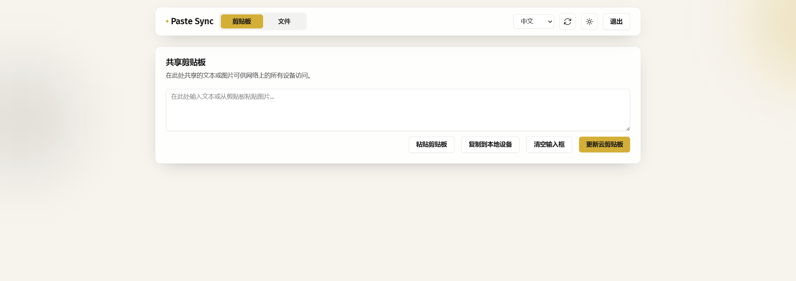
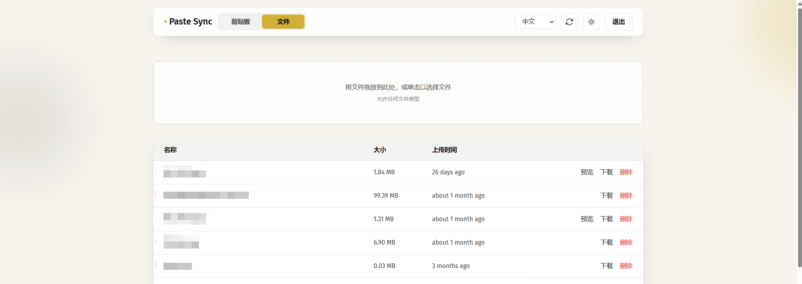
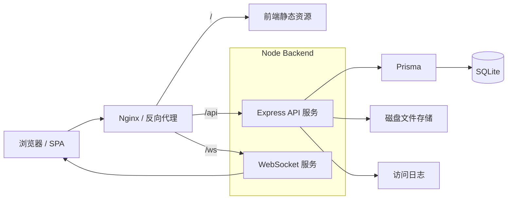

# Paste Sync

一个支持密码保护的剪贴板与文件共享应用，可在局域网内或通过公网反向代理，在自己的设备之间快速同步文本、剪贴板图片和文件。

[English README](./README.md)

## 界面展示

### 剪贴板



### 文件



## 架构图



## 功能特性

- **多账号登录**：使用用户名和密码登录，服务端签发 7 天有效 JWT。账号通过 `USERS` 环境变量配置。
- **账号间隔离**：每个账号拥有独立的剪贴板（文本与图片）和独立的文件列表，账号之间互不可见、互不影响，实时事件也只推送给所属账号。
- **剪贴板同步**：支持文本与当前剪贴板图片的上传、查看和清空。
- **文件共享**：支持上传、下载、删除与图片预览。
- **传输进度**：显示上传/下载进度，并支持取消当前传输。
- **实时刷新**：通过 WebSocket 广播剪贴板和文件列表变更。
- **多语言与主题**：支持中文 / 英文，以及浅色 / 深色 / 跟随系统主题。
- **Docker 部署**：支持 Docker Compose 快速启动。

## 快速开始

### 环境要求

- Docker + Docker Compose，或
- Node.js 18+ + npm

### 安装

```bash
git clone https://github.com/AlakaSquasho/paste_sync.git
cd paste_sync
npm install
```

### Docker 运行

可以选择拉取已构建好的镜像部署，也可以直接从源码本地构建。

使用预构建镜像：

```bash
docker-compose -f docker-compose.image.yml up -d
```

本地构建：

```bash
docker-compose up -d --build
```

推荐保留两份 Compose 文件：`docker-compose.yml` 用于本地构建，`docker-compose.image.yml` 用于拉取预构建镜像。两者可以复用相同的端口、数据卷和环境变量，只需要把 `build` 换成 `image`。

访问：
- 前端：http://localhost:8080
- 后端：http://localhost:3000

### 本地开发

```bash
npm run dev
```

访问：
- 前端：http://localhost:5173（默认，可通过 `VITE_DEV_PORT` 修改）
- 后端：http://localhost:3000（默认，可通过 `PORT` 修改）

### 生产构建

```bash
npm run build
npm run start
```

## 认证与同步

- 登录接口：`POST /api/auth/login`，请求体为 `{ "username": ..., "password": ... }`
- REST 鉴权：`Authorization: Bearer <token>`
- WebSocket 鉴权：`/ws?token=...`
- 服务端广播 `clipboard_updated` 和 `files_updated` 事件，前端收到后重新拉取对应数据

账号由 `USERS` 环境变量定义，格式为逗号分隔的 `用户名:密码`。密码支持明文或 Bcrypt 哈希。用户名同时用作账号标识（数据库归属字段、上传目录名、JWT 的 `sub`），所有请求都会按登录账号做作用域过滤，因此即使持有有效 token，也无法访问其他账号的文件或剪贴板内容。

事件只推送给发生变更的账号所连接的 socket，其他账号的浏览器不会因你的改动而刷新。

## 数据与部署

- 数据库：SQLite（Prisma）
- 普通文件：`server/uploads/<用户名>/`
- 剪贴板图片：`server/uploads/clipboard/<用户名>/`
- 日志：`server/logs/`
- Docker 会持久化挂载数据库、uploads 和 logs

升级前已存在的数据会在升级后的首次启动时归入默认账号目录——详见[从单账号升级](#从单账号升级)。

项目附带公网反代模板：`nginx.reverse-proxy.template.conf`。你可以通过自己的域名或 HTTPS 网关暴露应用；只要反向代理配置安全，使用场景不局限于局域网。

- `/` → `127.0.0.1:8080`
- `/api`、`/ws` → `127.0.0.1:3000`

如果设置了 `MAX_UPLOAD_SIZE_MB`，请同时保持外层 Nginx 的 `client_max_body_size` 一致。

## 配置项

可通过 `docker-compose.yml` 或 `.env` 配置（参考 `.env.example`）：

- `USERS`：逗号分隔的 `用户名:密码` 账号列表，例如 `USERS='alice:$2b$10$...,bob:明文密码'`。密码支持明文或 Bcrypt。用户名需匹配 `[A-Za-z0-9._-]{1,32}`，并按大小写不敏感方式判重。
- `DEFAULT_ACCOUNT`：继承升级前已有数据的账号，默认取 `USERS` 的第一项。
- `SHARED_PASSWORD`：旧版单账号回退，仅在 `USERS` 为空时生效，会创建名为 `DEFAULT_ACCOUNT`（未设置时为 `default`）的账号。
- `JWT_SECRET`：JWT 签名密钥。必填——为空或使用占位值时服务会在启动阶段直接失败，因为可猜测的密钥会让任何人都能伪造任意账号的 token。
- `PORT`：后端端口，默认 `3000`
- `DATABASE_URL`：SQLite 连接串
- `LOG_DIR`：日志目录
- `IPINFO_API_KEY`：访问日志 IP 属地增强
- `MAX_UPLOAD_SIZE_MB`：上传大小限制，需与 Nginx 保持一致

生成密码哈希：

```bash
node -e "console.log(require('bcryptjs').hashSync('你的密码', 10))"
```

Bcrypt 哈希含有 `$`，当 `USERS` 中包含哈希时请用单引号包裹整个值。

## 从单账号升级

升级前已存在的数据，会在升级后的首次启动时自动归给某一个账号：

1. `add_user_ownership` 迁移给已有的剪贴板、剪贴板图片、文件记录打上保留占位归属 `__legacy__`。
2. 服务启动时把这些记录改归 `DEFAULT_ACCOUNT`，并把平铺的文件从 `server/uploads/` 搬进 `server/uploads/<账号>/`、从 `server/uploads/clipboard/` 搬进 `server/uploads/clipboard/<账号>/`。

两步都是幂等的。Docker 下迁移在容器入口脚本里、服务启动之前执行。想确认实际发生了什么，看服务日志里的 `[ownership]` 行：

```bash
docker compose logs server | grep ownership
```

如果此时还没配置 `USERS`，会先创建一个名为 `default` 的账号（用 `SHARED_PASSWORD`），已有数据就落在 `server/uploads/default/` 下。

### 更换数据归属的账号

这个归属动作**只发生一次**。之后这些记录就不再带 `__legacy__` 占位了，所以再改 `DEFAULT_ACCOUNT` **不会**搬动任何东西——这是刻意的，避免改配置时意外移动你的文件。如果数据落在了回退账号 `default` 下，而你想用自己的账号名，有两条路：

- **直接把 `default` 当账号名用。** 最省事，且完全不动数据：在 `USERS` 里加上 `default:你的密码` 即可。
- **改名。** 用一次性脚本，它会把文件和数据库记录一起搬过去：

  ```bash
  docker compose down
  cp -r server/uploads server/uploads.bak
  cp server/prisma/data/prod.db server/prisma/data/prod.db.bak

  # 先干跑——只打印计划，不改动任何东西
  node server/scripts/renameAccount.mjs default <你的账号名>
  # 确认无误后加 --apply 实际执行
  node server/scripts/renameAccount.mjs default <你的账号名> --apply

  docker compose up -d
  ```

之后把 `DEFAULT_ACCOUNT`（以及 `USERS`）指向新名字。脚本要求运行环境有 Node 22+，默认按 Docker 的目录布局（`server/uploads`、`server/prisma/data/prod.db`）取路径，布局不同时用 `UPLOADS_DIR=` 和 `DB_PATH=` 覆盖。如果目标账号下已经有文件，脚本会拒绝执行，因此不可能悄悄合并两个账号。

## 常用命令

```bash
npm run dev
npm run build
npm run start
npm run dev --workspace=client
npm run dev --workspace=server
```

## 技术栈

- 前端：React、TypeScript、Vite、Tailwind CSS、i18next
- 后端：Node.js、Express、Prisma、ws
- 数据库：SQLite
- 部署：Nginx、Docker Compose

## 开源协议

MIT
